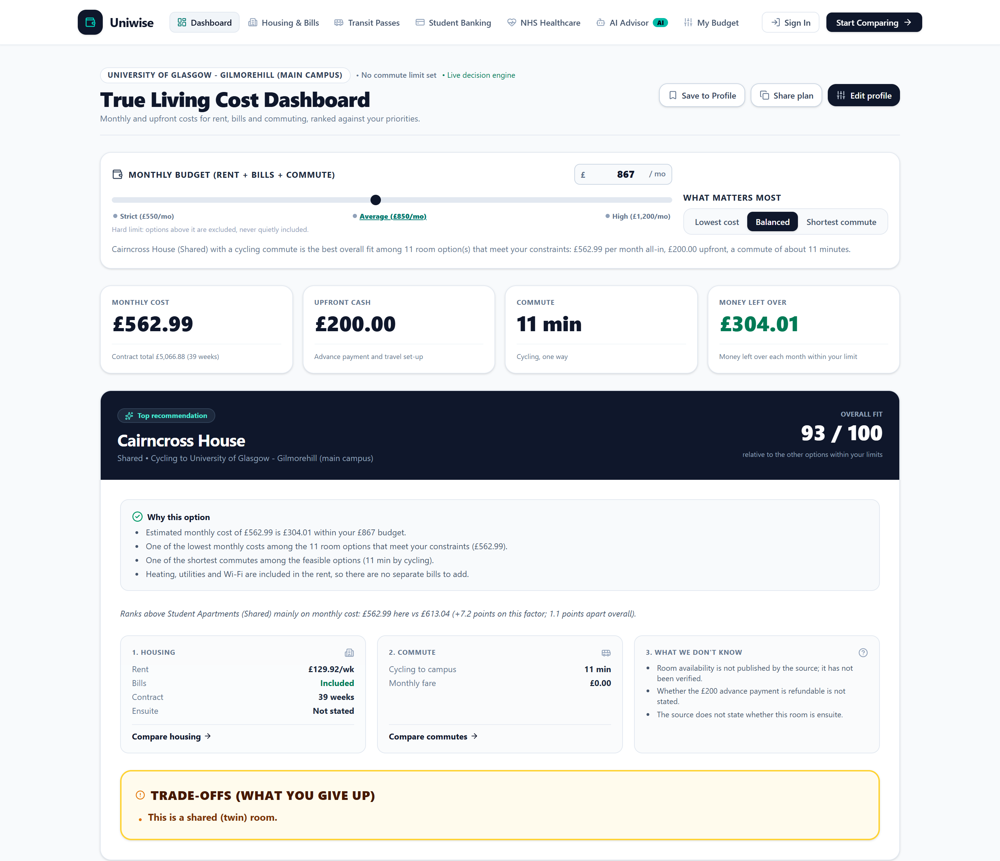

# Uniwise

> **GUTS Hackathon 2026 — BlackRock Aladdin Challenge** • University of Glasgow
> Helping an incoming University of Glasgow student choose the accommodation and commute that best fits their budget, travel limits and priorities — with every number traced to its source.



**Judges:** start with **[docs/JUDGING.md](docs/JUDGING.md)**. It has a 3-minute demo walkthrough with screenshots, how the engine decides, the data sources, failure handling, and where to find the evidence for each item on the brief's checklist.

---

## 🎯 User and decision

- **User:** an incoming University of Glasgow student (Scottish, rest-of-UK or international) choosing where to live.
- **Decision:** *which room and way of getting to campus gives the best overall fit* — not just the lowest rent.
- **Why combined data helps:** rent alone hides the real cost. The backend combines official accommodation fees with route and fare data, compares monthly and upfront costs separately, applies the student's hard limits, and explains the trade-offs.

---

## ✅ Current status

| Area | Status |
|---|---|
| Backend API and decision engine | Working, 71 automated tests passing |
| Accommodation and commute data | Working (University of Glasgow residences, Gilmorehill campus) |
| Web dashboard, accommodation, transport, landing-page trade-off | Connected to the backend |
| Mobile app | Tries the backend first, but most of the endpoints it calls don't exist yet, so it mostly runs on its own local calculation and mock data |
| Banking, healthcare | Frontend pages with illustrative content; **no verified backend data**; not used in recommendations |
| "Finley" chat assistant (`/chat`, floating widget) | Rule-based keyword matching with pre-written answers; **not a language model**; its figures are illustrative and not used in recommendations |
| Raw research files | Served read-only at `/api/v1/research`, labelled unverified; never used for recommendations |
| Docker Compose (backend + web) | Working |
| Supabase (sign-in, profiles, saved plans) | Working when a Supabase project is configured; optional, and the app works without it |
| AI summaries | Not started; the product calls no AI service |

> **Note on the frontend:** the dashboard, housing, transport and landing-page trade-off get every figure from the backend. The mobile app (`frontend/mobile/src/shared/`), the banking and healthcare pages and the Finley chat use their own local figures. Values shown there are **illustrative, not verified information**.

---

## 📁 Repository structure

```
uniwise/
├── backend/                  # Python FastAPI service
│   ├── app/
│   │   ├── api/              # HTTP routes
│   │   ├── services/         # Builds responses from engine results
│   │   ├── decision_engine/  # Constraints, costs, scoring, explanations (no I/O)
│   │   ├── providers/        # Loads data files; refresh script for public APIs
│   │   └── models/           # Request, response and domain models
│   ├── tests/                # Unit and integration tests
│   └── requirements.txt
├── data/
│   ├── curated/              # Transcribed from official pages, with source URLs and dates
│   ├── rawdata/              # Research files and scripts behind them (served read-only, never used for decisions)
│   └── reference/            # Cached results from public APIs (routes, coordinates, stations)
├── docs/
│   ├── JUDGING.md            # Judging guide: demo walkthrough, evidence, screenshots
│   ├── screenshots/          # Screenshots of the running app
│   └── openapi.json          # API contract (generated by FastAPI)
├── supabase/                 # Optional auth/profile schema (migrations, row-level security)
├── PROJECT_SPEC.md           # Product and engineering specification
├── frontend/
│   ├── web/                  # Next.js 16 web app (primary)
│   ├── mobile/               # React Native (Expo) app (secondary)
│   ├── shared/               # Shared types and API client
│   └── README.md             # Frontend design and pages
└── README.md
```

---

## 🏗️ Architecture

Three separate layers, as the challenge requires:

```
  Experience        frontend/web, frontend/mobile
                    displays results; does not calculate the recommendation
                         |
                         |  HTTP + JSON  (/api/v1/...)
                         v
  Decision          backend/app/api -> services -> decision_engine
                    validation, constraints, costs, scoring, explanations
                         |
                         v
  Data integration  backend/app/providers
                    reads data/curated and data/reference (data/rawdata is served read-only, outside the decision path)
                         ^
                         |  run manually: python -m app.providers.refresh
                    postcodes.io, DfT NaPTAN, FOSSGIS OpenStreetMap routing
```

The running backend calls no external service. Route data is fetched from public APIs by the refresh script and saved, so a demo never depends on the network. A failed refresh keeps the last good data.

---

## ⚖️ Architectural trade-offs

Each choice below was made on purpose. The cost is listed next to it.

**Few reliable sources over a broad catalogue.** The decision engine uses University of Glasgow residences, transcribed by hand from official pages with source URLs and dates. A broader list of private-operator residences exists in `data/rawdata/`, but it has no source URLs or verification dates, and getting the data from listing sites would mean working around their access rules. We chose the smaller, traceable set. *Cost:* fewer rooms, and only Gilmorehill as a campus.

**A deterministic engine, with no AI.** The same profile always gives the same ranking, every figure traces to a rule and a source, and the tests can check the outcome. *Cost:* no free-text reasoning or natural-language summaries.

**Cached routes instead of live routing.** Walking and cycling times, coordinates and station locations are saved by the refresh script, so a demo never depends on the network, and a failed refresh keeps the last good data. *Cost:* the cache goes stale; the geo snapshot is treated as stale after 90 days, and the refresh is run by hand.

**Static JSON files instead of a database.** The decision data is versioned with the code and copied into the Docker image, so the setup is reproducible and needs no account. *Cost:* data can't be edited from the UI. Per-user data (sign-in, saved profile, saved plans) goes to Supabase only when it is configured, with row-level security so each user sees only their own rows. Without Supabase, the profile stays in the browser.

**Calculations only in the backend.** The web app displays results and does not calculate them. This removed a duplicate copy of the cost logic that could drift from the backend. *Cost:* the web app needs the API running, and the mobile app still has its own copy until it is connected.

**Relative scores.** Monthly cost, commute time, upfront cost and evidence confidence are each scaled 0 to 1 across the options that passed the hard limits, then weighted. *Cost:* a score of 80 means "best of this set", not "80 out of 100 in general". The hard limits and the explanations are there to make that clear.

**Separate, labelled research data.** The raw research files are served under `/api/v1/research`, marked `unverified`, and kept out of the decision path. *Cost:* the app can show data that is not decision-grade, so the display has to carry the label.

**Estimates are marked as estimates.** Subway journey times are estimated from a secondary source, and bus journeys are not modelled. *Cost:* commute comparisons are less precise for bus users.

---

## 🚀 Quick start

### Option A: Docker (backend + web app)

Requires Docker Desktop running.

```bash
docker compose up --build -d     # first build takes several minutes
# Web app: http://localhost:3000    API docs: http://localhost:8000/docs
docker compose ps                # status (backend shows "healthy" when ready)
docker compose logs -f backend   # follow logs
docker compose run --rm --no-deps backend python -m pytest -q   # tests inside the container
docker compose down              # stop and remove the containers
```

Notes:
- `NEXT_PUBLIC_API_URL` is baked into the web build. After changing it, rebuild with `docker compose build web`.
- The data files are copied into the backend image. After editing `data/` or running a refresh, rebuild with `docker compose build backend`.
- Ports 3000 and 8000 must be free (stop any locally running dev servers first).
- The mobile app is not containerised; run it with Expo as below.

### Option B: run locally

### Backend (Python 3.12+, tested on 3.14)

```bash
cd backend
python -m venv .venv
# Windows: .venv\Scripts\activate     macOS/Linux: source .venv/bin/activate
pip install -r requirements.txt

python -m pytest -q                    # run the tests
python -m uvicorn app.main:app --reload --port 8000
# API docs: http://127.0.0.1:8000/docs
```

Optional: refresh the cached route data (needs internet):

```bash
python -m app.providers.refresh
```

### Web app (Next.js 16)

```bash
cd frontend/web
npm install
echo NEXT_PUBLIC_API_URL=http://localhost:8000 > .env.local
npm run dev
# Open http://localhost:3000
```

Optional, to enable sign-in and saved plans: add `NEXT_PUBLIC_SUPABASE_URL` and `NEXT_PUBLIC_SUPABASE_ANON_KEY` (public values only, see `.env.example`) and apply `supabase/migrations/` to the project. For Docker, put them in the root `.env` and rebuild with `docker compose build web`.

### Mobile app (Expo)

```bash
cd frontend/mobile
npm install
npm run web    # or: npm run android / npm run ios
```

---

## 🔌 API

Base path: `/api/v1`. Full contract: [`docs/openapi.json`](./docs/openapi.json), or the interactive docs at `/docs` while the backend runs.

| Method | Path | Purpose |
|---|---|---|
| GET | `/health` | Server status and whether each data source loaded |
| GET | `/sources/status` | Every data source, its status and when it was verified |
| GET | `/accommodations` | List rooms. Filters: `ensuite`, `accessible`, `studio`, `max_weekly_rent_gbp`. Sort: `weekly_rent`, `name` |
| GET | `/accommodations/{accommodation_id}` | One room in full |
| GET | `/research` | Raw research datasets (unverified), with their tables. Not used by recommendations |
| GET | `/research/{dataset_id}` | One raw research dataset: `accommodation-catalogue`, `nearby-stores`, `transport-research` or `bank-accounts` |
| GET | `/transport/options` | Walk, cycle and Subway options from a residence to campus, with cost and time |
| POST | `/recommendations/setup` | **Main endpoint.** Takes a student profile, returns ranked options with costs, score breakdown, reasons, trade-offs and unknowns |

Every error uses one format:

```json
{ "error": { "code": "validation_error", "message": "...", "details": [] } }
```

Codes: `validation_error` (422), `not_found` (404), `method_not_allowed` (405), `provider_unavailable` (503), `internal_error` (500).

The backend accepts browser requests from `http://localhost:3000` (Next.js) and `http://localhost:8081` (Expo web). Add others with the `UNIWISE_CORS_ORIGINS` environment variable.

---

## 📊 Data sources

| Source | What it provides | How it is obtained | Status |
|---|---|---|---|
| [University of Glasgow — accommodation fees](https://www.gla.ac.uk/undergraduate/accommodation/fees/) and residence pages | 2026/27 rents, contract dates, bills included, £200 advance payment, addresses | Transcribed by hand | `curated` |
| [SPT — Subway tickets](https://www.spt.co.uk/tickets/subway-tickets/) and [2026 fares notice](https://www.spt.co.uk/about-us/news/subway-fares-revised-for-2026/) | Smartcard, single, daily and 28-day fares | Transcribed by hand | `curated` |
| [Transport Scotland — Under 22s free bus travel](https://www.transport.gov.scot/concessionary-travel/under-22s-free-bus-travel/) | Eligibility rules and restrictions | Transcribed by hand | `curated` |
| [postcodes.io](https://postcodes.io/), [DfT NaPTAN API](https://naptan.api.dft.gov.uk/), [FOSSGIS OpenStreetMap routing](https://routing.openstreetmap.de/) | Coordinates, Subway station locations, walking and cycling times | Public APIs, saved by the refresh script | `cached` |
| [UK Tram — SPT Subway overview](https://www.uktram.org/all-systems/spt-subway) | Subway circuit time (24 min, 15 stations) | Secondary source | `estimated` |

Status meanings: `curated` = copied from an official page with a verification date; `cached` = saved from a public API at a recorded time; `estimated` = calculated from a stated assumption; `stale` = older than its freshness window; `unavailable` = failed to load.

**What is deliberately left unknown:** room availability (not published), whether the advance payment is refundable, ensuite status where the source doesn't say, and student Subway fares (SPT publishes none, so adult fares are used).

### Raw research files (`data/rawdata/`)

These files are kept for reference. The backend serves them read-only under `/api/v1/research` so the app can display them, labelled `unverified`. **Recommendations never use them**, and none of their figures appear in a recommendation. They are raw and unverified unless stated otherwise.

| File | What it contains | Status | Notes |
|---|---|---|---|
| `accomodation (1).csv`, `accomodation (2).csv` | 50 private student residences (Unite, iQ, Vita, Yugo and others) with weekly rent, contract length and facilities | Raw, unverified | The two files are identical. These are private-operator blocks, not University of Glasgow residences, so they are the broader, unverified catalogue the backend deliberately left out in favour of the curated list |
| `accomodation_distance_to_unis.csv` | The same residences with coordinates and walking distance and time to the University of Glasgow, Strathclyde and GCU | Cached from public APIs | Produced by `calculate_distances.py` (postcodes.io, Nominatim, OSRM and OpenStreetMap routing). No save date is recorded in the file |
| `accomodation_nearby_stores.csv` | Up to three nearby supermarkets per residence, with distance and walking time | Estimated | Produced by `fetch_nearby_stores.py` from a store list typed into the script. The script labels these "verified", but no check date is recorded |
| `glasgow_student_transport_research.xlsx` | Transport modes, concessions (Young Scot NEC, 16–25 Railcard), journey planners and suggested app data fields | Research leads | The sheet itself says fares are unverified. Only the Subway and concession rules in `data/curated/` come from official pages |
| `glasgow_student_bank_accounts_dataset (1).xlsx` | Comparison of nine banks and money apps for international students, plus a verification checklist | Raw, unverified | Every entry is marked "Research lead, current terms not live-verified". The verification-date column shows 2026-10-17, which is the research date, not a check against the bank's site |
| `Healthcare_Developer_Handoff (2).docx` | Product handoff for an NHS navigation app for international students: screens, entitlement rules, emergency numbers and a data schema | Planning notes | A specification, not a dataset. It is for a separate healthcare feature and says charges, hours and contacts must be checked before use |
| `calculate_distances.py`, `fetch_nearby_stores.py` | Scripts that generated the two distance and store CSVs | Scripts | Run manually; they need internet access |

---

## 🧮 How the recommendation works

1. **Hard limits first.** Options over a hard budget, upfront limit or commute limit, or missing a required feature, are excluded with a reason. A requirement that can't be checked because data is missing counts as not met.
2. **Costs.** Monthly = rent (weekly × 52 ÷ 12) + bills (zero when included) + transport. Upfront = advance payment + transport set-up. Unknown values stay unknown, never zero.
3. **Scoring.** Monthly cost, commute time, upfront cost and evidence confidence are each scaled 0–1 across the options that passed, then weighted by the student's priorities (0–10). Evidence confidence is capped at 20% of the weight.
4. **Explanation.** Reasons, compromises, unknowns and the main difference from the runner-up are generated from the numbers.

Scores are **relative to the options that passed**, not absolute ratings.

If nothing passes, the API returns `no_feasible_options` and suggests which limit to relax — it never recommends an option that breaks a hard limit.

---

## ⚠️ Known limitations

- Only University of Glasgow residences and the Gilmorehill campus are covered.
- Subway journey times are estimates; bus journeys are not modelled.
- The mobile app is not connected to the backend, and banking, healthcare and the Finley chat have no verified backend data (see status above).
- ESLint reports 3 errors in `frontend/web/src/app/banking/page.tsx`; the pages on the decision path lint clean.
- The web Docker image is large (about 1.35 GB); Next.js `standalone` output would shrink it.

---

## 🤖 Responsible AI

**Where we used AI: building the app.** Most of the code was written by AI coding assistants, working to our instructions. The repository includes `AGENTS.md` files and [spec section 25](./PROJECT_SPEC.md) for that workflow. The team decided what to build and how, and broke the work into tasks for the assistants. We reviewed what they produced and kept, changed or rejected it. Every change was checked with the 71 backend tests, the linter and the type checker before it was kept.

**Where the running app uses AI: it doesn't.** We chose not to put a language model in the decision. Neither the backend nor the frontends call one at runtime. Recommendations, costs, scores and explanations come from deterministic code in `backend/app/decision_engine`, so the same profile always gets the same answer, and tests check it.

**About "Finley".** The chat assistant is labelled "AI Advisor" in the interface, but it's rule-based. It matches keywords in the question and fills in pre-written answers (`frontend/web/src/shared/calculations/chat-engine.ts`). Its figures, such as estimated bills or a 5-week deposit, are illustrative general guidance. They don't come from the decision engine and don't affect any recommendation. The client tries a `/api/v1/chat` endpoint first; the backend doesn't implement one, so the local rules always answer.

**What stayed human.** All the engineering decisions: the architecture and its three-layer split, the API contract, choosing the data sources and what to exclude, transcribing and dating the curated figures, the scoring factors, weights and hard-limit rules, how failures are handled, and every product and design decision.

**How the output is checked.** The engine is deterministic, so the same profile always gives the same result, and the tests cover constraints, costs, scoring and the HTTP contract. The raw research files are shown with an `unverified` label and are kept out of the decision path.

**If AI is unavailable or wrong.** Nothing depends on AI at runtime, so there is no AI-dependent path to fall back from. If AI summaries are added later, they will be checked against the same structured facts, fall back to the template text when unavailable, and be disclosed here.

---

For frontend design and page details, see [frontend/README.md](./frontend/README.md).
