# Uniwise — Judging Guide

> **GUTS Hackathon 2026 · BlackRock Aladdin Challenge — "One app. One clear decision."**
> Uniwise helps an incoming University of Glasgow student choose **which room and which way of getting to campus** gives the best overall fit, using the true monthly cost, the cash needed up front, the commute and the student's own limits, with every figure traced to its source.


*The dashboard for our example student. Live output from the decision engine, not a mock-up.*

---

## Contents

1. [The 30-second pitch](#1-the-30-second-pitch)
2. [One user, one decision](#2-one-user-one-decision)
3. [Why combined data gives a better decision](#3-why-combined-data-gives-a-better-decision)
4. [Demo walkthrough (3 minutes)](#4-demo-walkthrough-3-minutes)
5. [How the recommendation is made](#5-how-the-recommendation-is-made)
6. [Data sources and provenance](#6-data-sources-and-provenance)
7. [Architecture](#7-architecture)
8. [API-first design](#8-api-first-design)
9. [Graceful failure](#9-graceful-failure)
10. [Engineering standards](#10-engineering-standards)
11. [Responsible use of AI](#11-responsible-use-of-ai)
12. [What is verified and what is illustrative](#12-what-is-verified-and-what-is-illustrative)
13. [Submission checklist: where to find the evidence](#13-submission-checklist-where-to-find-the-evidence)
14. [Screenshot index](#14-screenshot-index)
15. [Run it yourself](#15-run-it-yourself)

---

## 1. The 30-second pitch

Students budget on **headline rent**. But the real decision combines three things that interact:

| What the student sees on a listing | What actually decides whether they can afford it |
|---|---|
| £129.92 a week | **£562.99 a month all-in**, because rent × 52 ÷ 12 = £562.99 and bills are included here |
| "15 min to campus" | **11 min by bike, 17 min on foot, 31 min by Subway** (the Subway is slower from this residence and costs £59.79 a month) |
| Nothing about move-in cash | **£200 advance payment** before the keys, with refund terms not published |

Uniwise brings together official University of Glasgow fees, SPT Subway fares, Transport Scotland concession rules and OpenStreetMap routing. It removes every option that breaks the student's hard limits, ranks the rest against their priorities, and explains **why it won, what they give up and what is still unknown**.

---

## 2. One user, one decision

**User.** Priya (a synthetic persona) is 19, an international student starting at the University of Glasgow's Gilmorehill campus in September 2026. She can spend about **£867 a month** on rent, bills and getting to campus combined, she's on campus five days a week, and she will walk, cycle or take the Subway.

**Decision.** *"Which University of Glasgow room, combined with which way of getting to campus, gives me the best overall fit for my budget, my travel time and the cash I need on arrival?"*

**The output.** One recommendation (room + transport mode), a ranked shortlist, a score breakdown, trade-offs, unknowns and next steps, each linked to the official source.

---

## 3. Why combined data gives a better decision

No single source answers Priya's question:

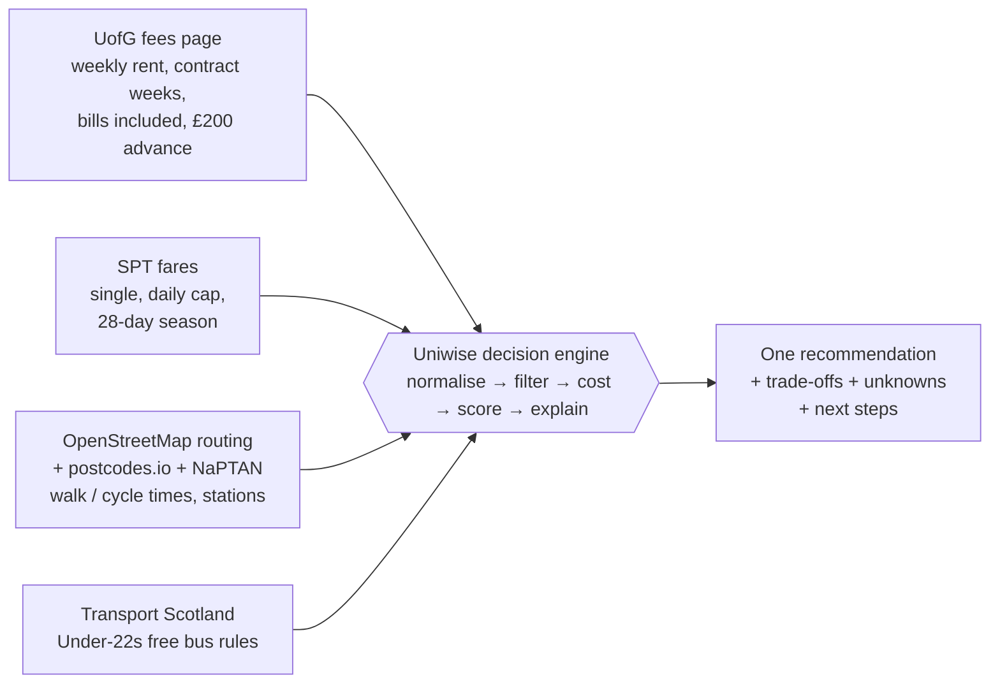

What the combination reveals that no single source shows:

- **Cheapest rent does not always mean cheapest month.** The engine adds a commute cost to each room. From Cairncross House the Subway costs **£59.79 a month** and is *slower* than cycling (31 min vs 11 min), so the engine pairs that room with cycling.
- **Monthly and upfront costs are kept apart.** A room can be affordable each month and still need cash the student hasn't got on arrival. The dashboard shows both.
- **The student's priorities change the answer, and the app says so.** Switching from *Balanced* to *Shortest commute* changes the winner from Cairncross House (£562.99, 11 min) to Student Apartments (£613.04, 3 min). The app states the cost of that choice: **£50.05 more a month to save 8 minutes each way**.

| Priority | Recommendation | Monthly all-in | Commute | Fit |
|---|---|---|---|---|
| Balanced | Cairncross House (Shared), cycling | **£562.99** | 11 min | 93/100 |
| Shortest commute | Student Apartments (Shared), cycling | £613.04 | **3 min** | 97/100 |

<table>
<tr>
<td width="50%">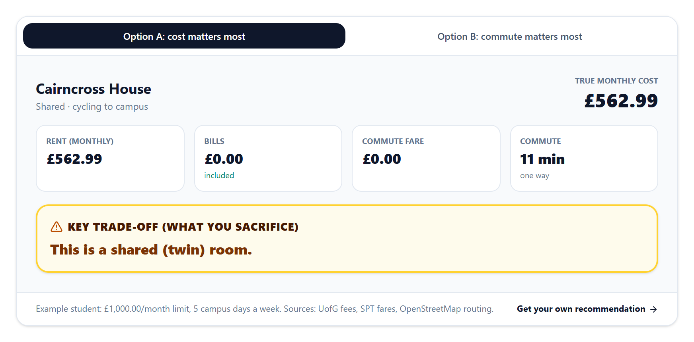</td>
<td width="50%">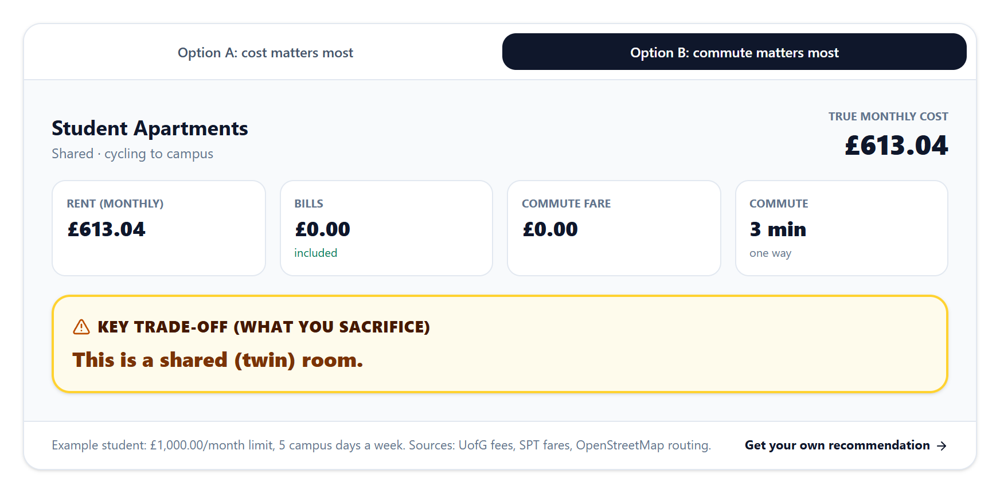</td>
</tr>
<tr>
<td><b>Option A: cost matters most.</b> Cairncross House, £562.99/month, 11 min.</td>
<td><b>Option B: commute matters most.</b> Student Apartments, £613.04/month, 3 min.</td>
</tr>
</table>

*The landing page calls the live decision engine twice with the same student and different priorities. Both results come from the backend.*

---

## 4. Demo walkthrough (3 minutes)

Each step lists the screen, what to show and what the judge should notice.

### Step 1: Landing page (20 s)

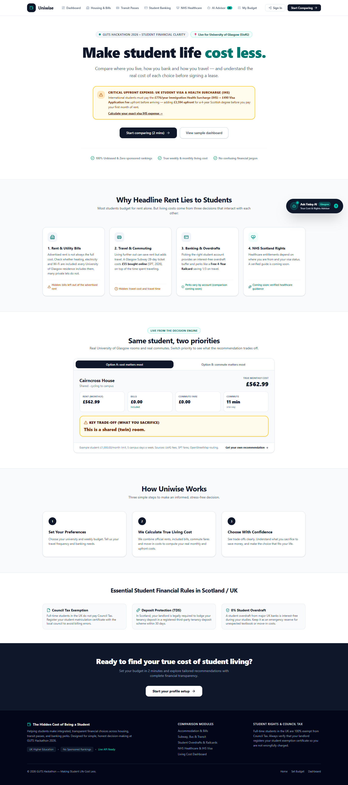

- **Show:** the "Same student, two priorities" panel. Click **Option B**.
- **Notice:** the recommendation, cost and trade-off change. The footer of the panel names the sources: *UofG fees, SPT fares, OpenStreetMap routing*.

### Step 2: Onboarding (20 s)

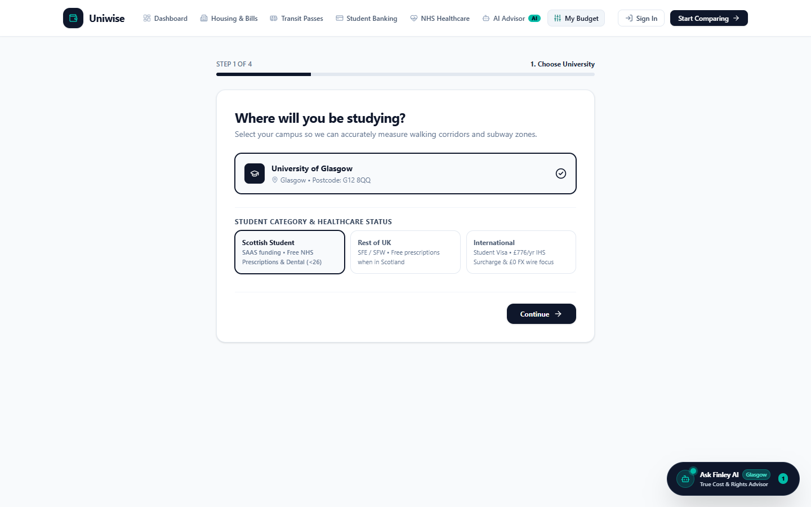

- **Show:** the 4-step profile (campus, student category, budget, transport and priorities).
- **Notice:** the student category (Scottish, rest of UK, international) is captured because it changes eligibility, for example for the Under-22s free bus scheme.

### Step 3: The recommendation (60 s): the core of the product

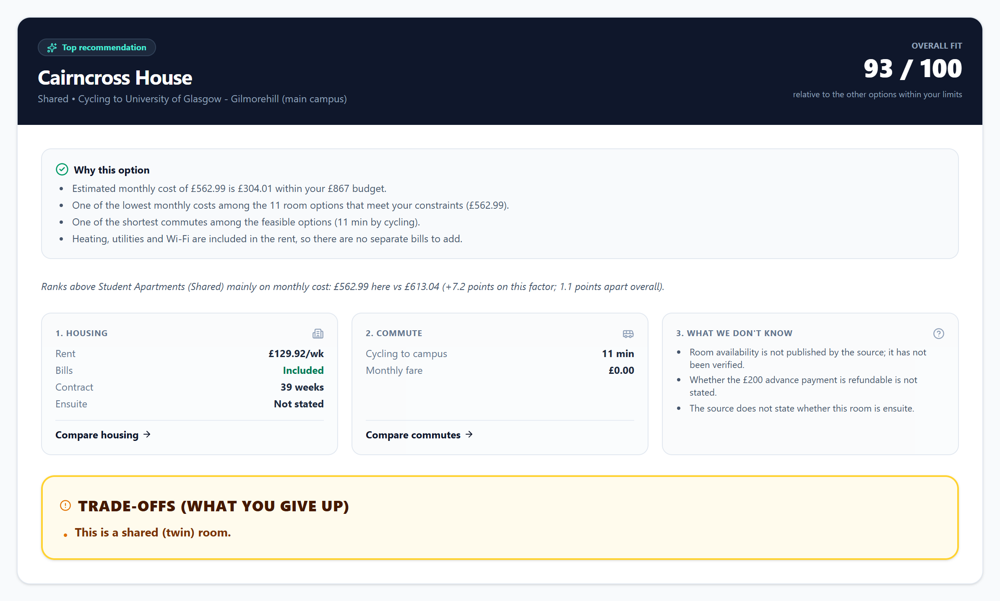

Point at, in order:

1. **Overall fit 93/100, "relative to the other options within your limits".** We don't pretend it's an absolute rating.
2. **Why this option.** Four reasons generated from the numbers, for example "£562.99 is £304.01 within your £867 budget".
3. **The runner-up line:** *"Ranks above Student Apartments (Shared) mainly on monthly cost: £562.99 here vs £613.04 (+7.2 points on this factor; 1.1 points apart overall)."* This shows the decision is close, and why.
4. **What we don't know.** Room availability isn't published, the refund terms for the £200 advance payment aren't stated, and ensuite status isn't stated. Unknowns stay unknown and are **never treated as zero**.
5. **Trade-offs (what you give up).** This is a shared (twin) room.

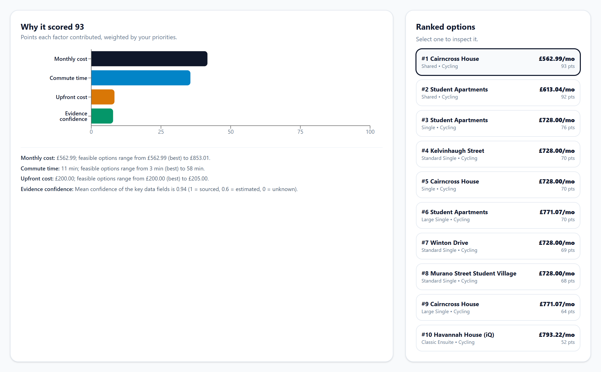

- **Why it scored 93:** the points each factor contributed, weighted by the student's priorities, with the range across feasible options (monthly cost from £562.99 to £853.01, commute from 3 to 58 min).
- **Ranked options:** all feasible options. Click one to inspect it.

### Step 4: Change a priority (20 s)

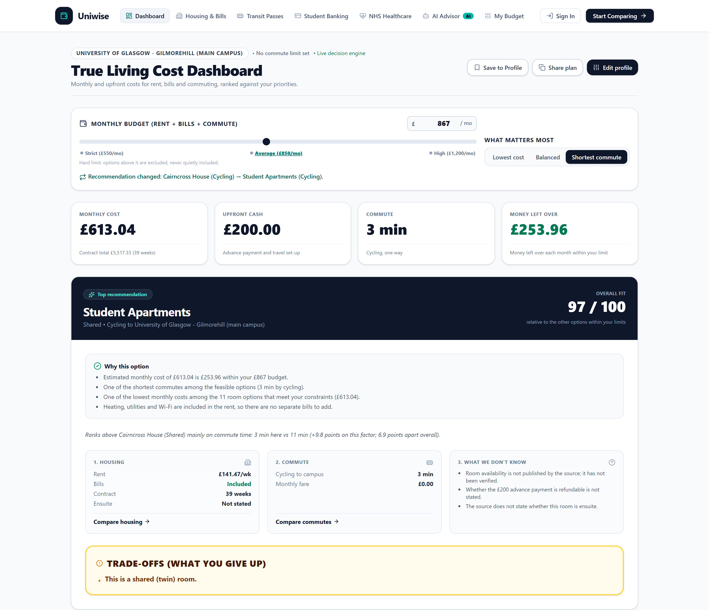

- **Show:** click **Shortest commute** under *What matters most*.
- **Notice:** the banner *"Recommendation changed: Cairncross House (Cycling) → Student Apartments (Cycling)"*, the new reasons and the new runner-up line (*"mainly on commute time: 3 min here vs 11 min"*).

### Step 5: Upfront cash, next steps and sources (20 s)

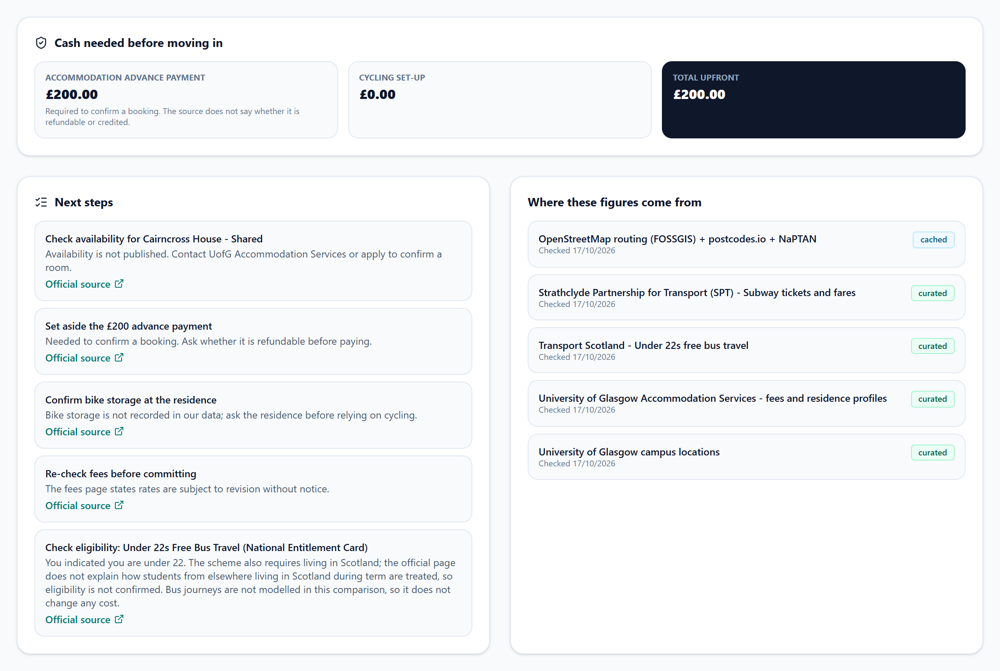

- **Cash needed before moving in:** £200 advance payment + £0 cycling set-up = **£200 total upfront**.
- **Next steps:** check availability, set aside the advance payment (and ask if it's refundable), confirm bike storage, re-check the fees, and check Under-22s bus eligibility. Each step links to the **official source**.
- **Where these figures come from:** every source with its status (`curated` / `cached`) and the date it was checked.

### Step 6: Break it on purpose (30 s)

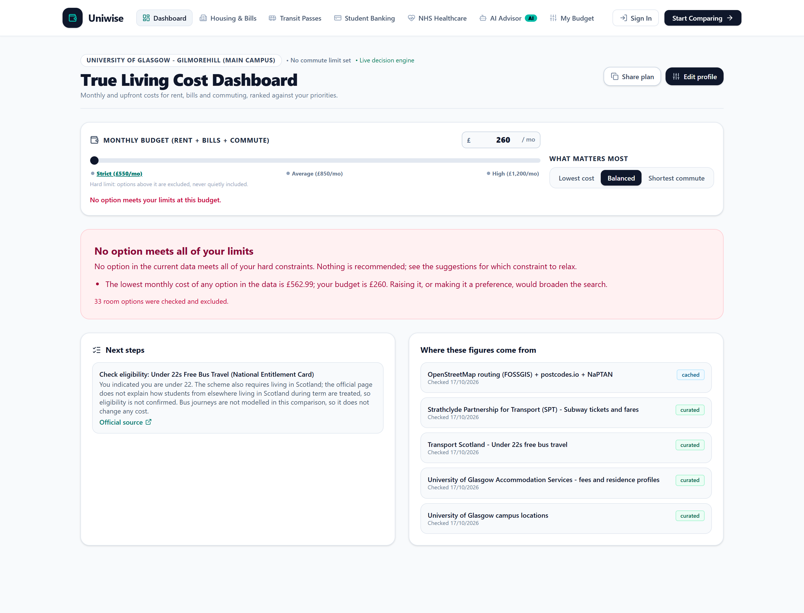

- **Show:** drag the budget down to £260.
- **Notice:** *"No option meets all of your limits … Nothing is recommended"*, followed by the smallest change that would help: *"The lowest monthly cost of any option in the data is £562.99; your budget is £260."* The engine **never recommends an option that breaks a hard limit**.

### Step 7: Supporting pages (10 s each, optional)

| Screen | What to point at |
|---|---|
| 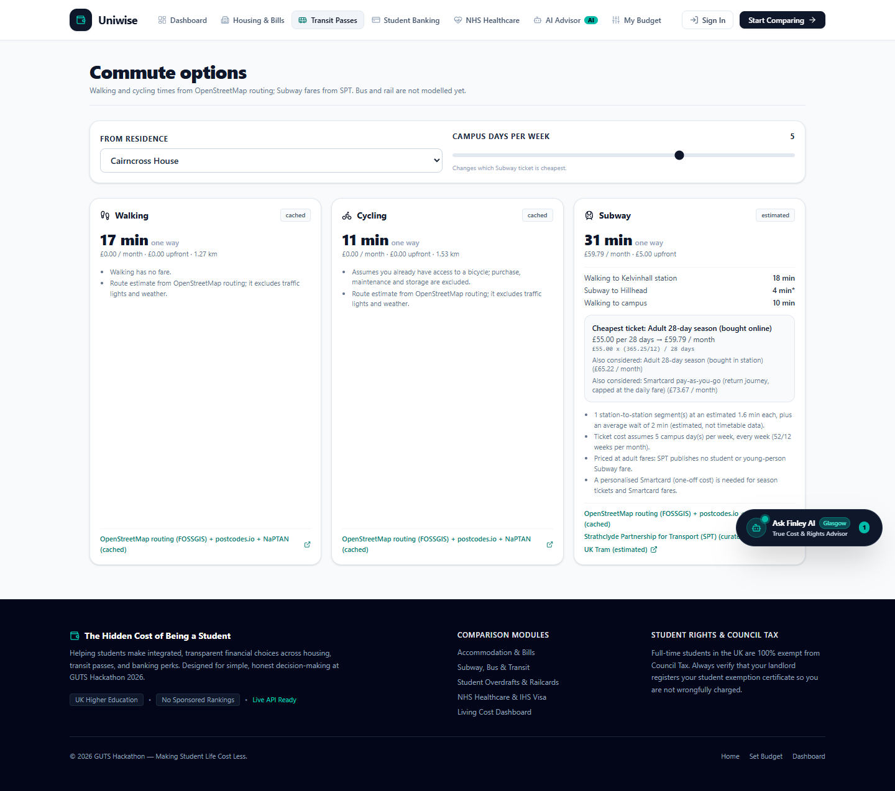 | **Commute options.** Walk 17 min, cycle 11 min, Subway 31 min from Cairncross House. The Subway card shows the cheapest ticket worked out (£55 per 28 days → £59.79/month), the alternatives it rejected, and the assumption that adult fares are used because SPT publishes no student fare. Each card has a status badge (`cached`, `estimated`). |
| 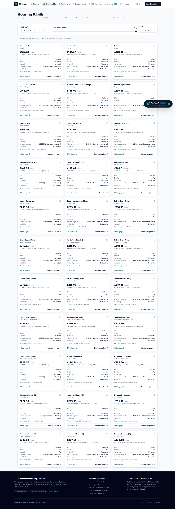 | **Housing & bills.** 33 room types from official UofG pages, with filters (ensuite, accessible, studio, max weekly rent). Every card says "Availability: Not verified" and "refund terms not stated" where the source is silent. |
| 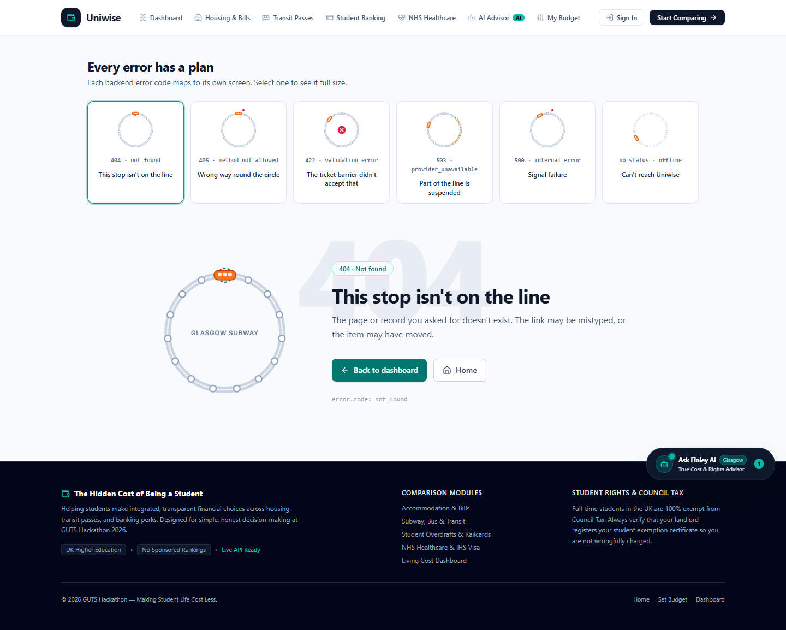 | **"Every error has a plan."** Each backend error code (404, 405, 422, 503, 500, offline) has its own screen, with an animated Glasgow Subway circle. |

---

## 5. How the recommendation is made

All of this happens in `backend/app/decision_engine/`. That code does no I/O, gives the same output for the same input, and is unit-tested.

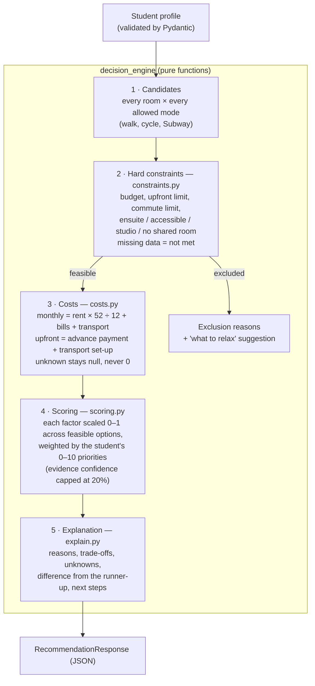

**A worked example (from the live API).** Priorities `monthly_cost 8, commute_time 5, upfront_cost 3` (evidence confidence left at its default of 1) are normalised into the weights the response reports:

| Factor | Priority (0–10) | Effective weight |
|---|---|---|
| Monthly cost | 8 | 0.47 |
| Commute time | 5 | 0.29 |
| Upfront cost | 3 | 0.18 |
| Evidence confidence | 1 | 0.06 |

Design choices:

- **Hard limits before scoring.** An option over budget is *excluded with a reason*. It is never ranked low and still shown as a recommendation.
- **Relative scores.** "93" means "best fit of this feasible set". The UI says this next to every score.
- **Missing data is honest.** If a required feature (for example ensuite) isn't stated by the source, the option does not pass that requirement, and the dashboard lists it under *What we don't know*.
- **Confidence counts but can't dominate.** Options built on `curated` data score slightly higher on evidence than `estimated` ones, but that factor is capped at 20% of the weight.

---

## 6. Data sources and provenance

| # | Source | Type | What it provides | How it gets in | Status in the app |
|---|---|---|---|---|---|
| 1 | [University of Glasgow: accommodation fees](https://www.gla.ac.uk/undergraduate/accommodation/fees/) and residence profiles | Official web pages | 2026/27 weekly rent, contract weeks and dates, bills included, £200 advance payment, addresses | Transcribed by hand → `data/curated/uofg_accommodation_2026_27.json` | `curated`, checked 17/10/2026 |
| 2 | [SPT: Subway tickets](https://www.spt.co.uk/tickets/subway-tickets/) and [2026 fares notice](https://www.spt.co.uk/about-us/news/subway-fares-revised-for-2026/) | Official web pages | Smartcard, single, daily cap, 28-day season fares | Transcribed → `spt_subway_fares_2026.json` | `curated` |
| 3 | [Transport Scotland: Under-22s free bus travel](https://www.transport.gov.scot/concessionary-travel/under-22s-free-bus-travel/) | Government page | Eligibility rules and restrictions | Transcribed → `concessions.json` | `curated` |
| 4 | [postcodes.io](https://postcodes.io/) (ONS data) | Public API | Residence and campus coordinates | `python -m app.providers.refresh` → `data/reference/geo_snapshot.json` | `cached`, with a retrieval timestamp |
| 5 | [DfT NaPTAN API](https://naptan.api.dft.gov.uk/) | Government API | Glasgow Subway station locations | Same refresh script | `cached` |
| 6 | [FOSSGIS OpenStreetMap routing](https://routing.openstreetmap.de/) | Public API | Walking and cycling durations and distances | Same refresh script | `cached` |
| 7 | [UK Tram: SPT Subway overview](https://www.uktram.org/all-systems/spt-subway) | Secondary source | Circuit time (24 min, 15 stations), used to estimate segment times | Stated assumption | `estimated` |

**Every figure carries its provenance.** In the API response, each room and each transport option has a `provenance` block with `source_id`, `source_url`, `status`, `retrieved_at` / `last_verified_at` and notes. The dashboard's *Where these figures come from* panel is built from this block.

**Freshness is checked.** `GET /api/v1/sources/status` reports each source's status. The geo snapshot is treated as `stale` after 90 days. The refresh script validates new data before replacing the old snapshot, and **keeps the last good snapshot** if any source fails.

**What we deliberately left out:** a 50-row private-hall catalogue (Unite, iQ, Vita and others) in `data/rawdata/`. It has no source URLs or verification dates, so it is served read-only under `/api/v1/research`, labelled `unverified`, and **never used in a recommendation**.

---

## 7. Architecture

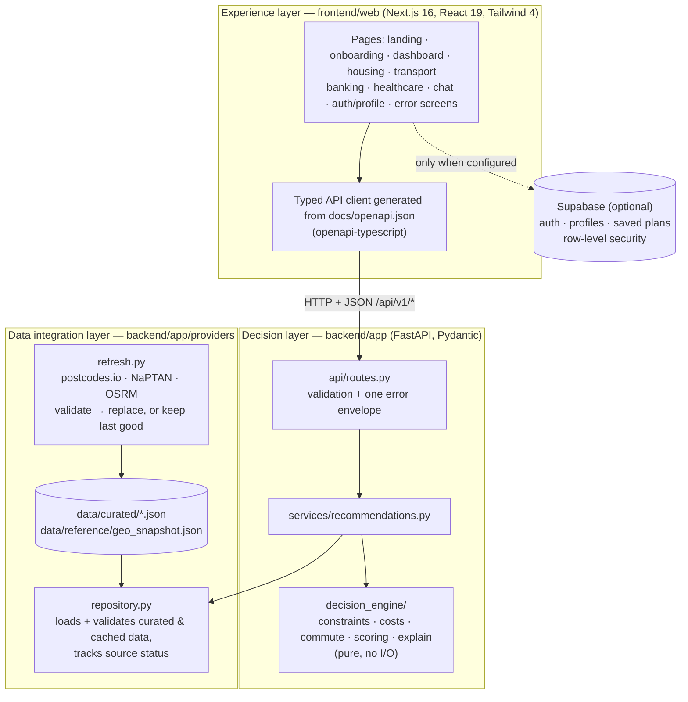

- **Separation is enforced, not just drawn.** The web app shows results and doesn't work them out. An earlier duplicate of the cost logic in the frontend was removed so it can't drift from the backend.
- **The running backend calls no external service.** Public-API data is fetched ahead of time by the refresh script, so a demo never depends on the venue Wi-Fi.
- **Supabase is optional.** Sign-in, saved profiles and saved plans work when the public Supabase URL and anon key are set. Without them, the app keeps the profile in the browser and everything else works. The schema (`supabase/migrations/`) turns on row-level security, so users can only read and write their own rows.

---

## 8. API-first design

The contract is in [`docs/openapi.json`](./openapi.json), and Swagger UI is at `http://localhost:8000/docs` while the backend runs. The frontend's TypeScript types are **generated from this file** (`npm run generate:api`), so the UI and API can't silently disagree.

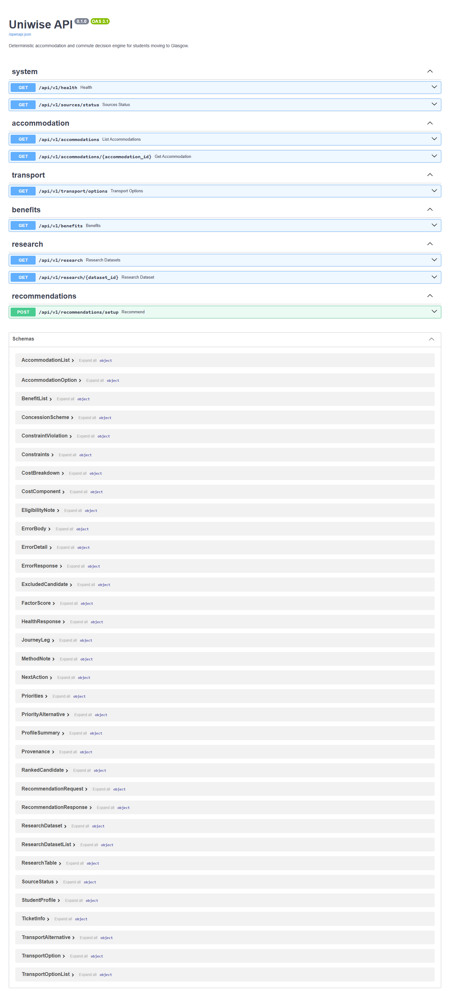

| Method | Path | Purpose |
|---|---|---|
| GET | `/api/v1/health` | Server status and whether each dataset loaded |
| GET | `/api/v1/sources/status` | Each source, its status and when it was verified |
| GET | `/api/v1/accommodations` | Rooms, with filters (`ensuite`, `accessible`, `studio`, `max_weekly_rent_gbp`) and sorting |
| GET | `/api/v1/accommodations/{id}` | One room in full |
| GET | `/api/v1/transport/options` | Walk / cycle / Subway from a residence to campus, with cost and time |
| GET | `/api/v1/benefits` | Concession rules (Under-22s bus travel) |
| GET | `/api/v1/research`, `/research/{id}` | Raw research datasets, labelled `unverified` |
| **POST** | **`/api/v1/recommendations/setup`** | **Main endpoint:** profile in, ranked recommendation out |

**Request** (the student profile):

```json
{
  "profile": {
    "student_category": "international",
    "age_band": "under_22",
    "campus_days_per_week": 5,
    "allowed_modes": ["walk", "cycle", "subway"],
    "constraints": { "max_monthly_budget_gbp": 867, "budget_is_hard": true },
    "priorities": { "monthly_cost": 8, "commute_time": 5, "upfront_cost": 3 }
  },
  "limit": 10
}
```

**Response** (trimmed from a real call):

```json
{
  "feasibility": "feasible",
  "ranking_confidence": "clear",
  "summary": "Cairncross House (Shared) with a cycling commute is the best overall fit among 11 room option(s) that meet your constraints: £562.99 per month all-in, £200.00 upfront, a commute of about 11 minutes.",
  "recommended_candidate_id": "cairncross-house--shared::cycle",
  "profile_summary": {
    "effective_weights": { "monthly_cost": 0.47, "commute_time": 0.29, "upfront_cost": 0.18, "evidence_confidence": 0.06 },
    "uncertainties": [
      "Room availability is not published by any source; no room is confirmed as available.",
      "Concession eligibility is not confirmed; no concession is included in any cost.",
      "22 room option(s) were excluded; see the exclusion reasons."
    ]
  },
  "ranked": [{
    "rank": 1,
    "accommodation": {
      "residence_name": "Cairncross House", "room_type": "Shared",
      "weekly_rent_gbp": 129.92, "monthly_rent_equivalent_gbp": 562.99,
      "bills_included": true, "advance_payment_gbp": 200.0,
      "advance_payment_refundable": null, "ensuite": null, "availability": "unknown",
      "provenance": { "source_id": "uofg_accommodation", "status": "curated", "last_verified_at": "2026-10-17T12:00:00Z" }
    },
    "transport": {
      "mode": "cycle", "duration_min": 10.7, "duration_status": "cached", "distance_km": 1.53,
      "monthly_cost_gbp": 0.0,
      "assumptions": ["Assumes you already have access to a bicycle; purchase, maintenance and storage are excluded."]
    }
  }]
}
```

Note the `null` values. `advance_payment_refundable: null` and `ensuite: null` mean *"the source does not say"*, and the UI shows exactly that.

**One error format everywhere:**

```json
{ "error": { "code": "validation_error", "message": "Request validation failed.",
             "details": [{ "field": "profile", "message": "Field required" }] } }
```

```json
{ "error": { "code": "not_found", "message": "No accommodation with id 'nope'.", "details": [] } }
```

Codes: `validation_error` (422), `not_found` (404), `method_not_allowed` (405), `provider_unavailable` (503), `internal_error` (500).

---

## 9. Graceful failure

| Situation | What happens | Evidence |
|---|---|---|
| **No option fits the student's limits** | API returns `no_feasible_options`. The UI says nothing is recommended and suggests which limit to relax | [`dashboard-no-feasible.png`](screenshots/dashboard-no-feasible.png) |
| **Backend unreachable** | The dashboard shows "Can't reach Uniwise" with *Try again*. No fake numbers are shown in place of real ones | ↓ below |
| **Unknown page or record** | Custom 404 "This stop isn't on the line" | [`10-not-found.png`](screenshots/10-not-found.png) |
| **Invalid input** | 422 with field-level `details`, from Pydantic validation (ranges, enums, duplicate modes, "at least one priority > 0") | Section 8 |
| **Public API fails during refresh** | The refresh script validates new data before replacing the old; on failure it keeps the last good snapshot and exits non-zero | `backend/app/providers/refresh.py` |
| **Data goes stale** | The geo snapshot is marked `stale` after 90 days and reported by `/sources/status` | `backend/app/providers/repository.py` |
| **Supabase not configured** | Auth features are hidden or disabled; the profile is kept in the browser and the rest of the app works | `frontend/web/src/lib/supabase.ts` |

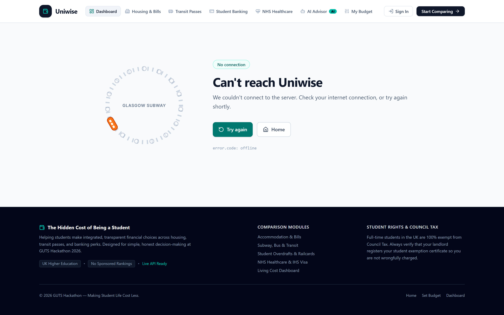

*To produce this screenshot, all requests to the backend were blocked. The dashboard doesn't fall back to made-up numbers.*

---

## 10. Engineering standards

| Standard | What we did |
|---|---|
| **Unit tests for core logic** | **71 passing tests** (`python -m pytest -q`) across `test_constraints`, `test_costs`, `test_scoring`, `test_engine`, `test_repository`, `test_research` |
| **Integration tests** | `test_api.py` (19 tests) drives the real FastAPI app over HTTP: the recommendation contract, error envelopes, filters and 404/405/422 handling |
| **Linting and formatting** | `ruff check` passes on the backend. ESLint runs on the web app (`npm run lint`); the decision-path pages are clean, and the remaining 3 errors are in the illustrative banking page |
| **Typed contract** | Pydantic models → OpenAPI → generated TypeScript types for the web client |
| **Reproducible setup** | `docker compose up --build` starts the backend and web app with a health check; the data is versioned in the repo and copied into the image |
| **Secret hygiene** | No secrets in the repo. `.env` is git-ignored. The web app uses only the *public* Supabase URL and anon key, never the service-role key |
| **Input validation** | Every request field has a type, a range or an enum; unknown modes and duplicate modes are rejected |
| **Web hardening** | Security headers (`X-Content-Type-Options`, `X-Frame-Options: DENY`, `Referrer-Policy`, `Permissions-Policy`); chat text is HTML-escaped before formatting; minimum password length is 8 |
| **Database security** | Supabase row-level security on `profiles`, `saved_plans` and `user_activity_logs`, so users can only access their own rows |
| **Accessible, responsive UI** | Semantic navigation with `aria-label`s, native buttons and form controls, error animations that respect `prefers-reduced-motion`, and a single-column layout on phones (below) |
| **Version control** | Feature branches merged through an integration branch, with a [branch audit](./BRANCH_INTEGRATION_REPORT.md) |

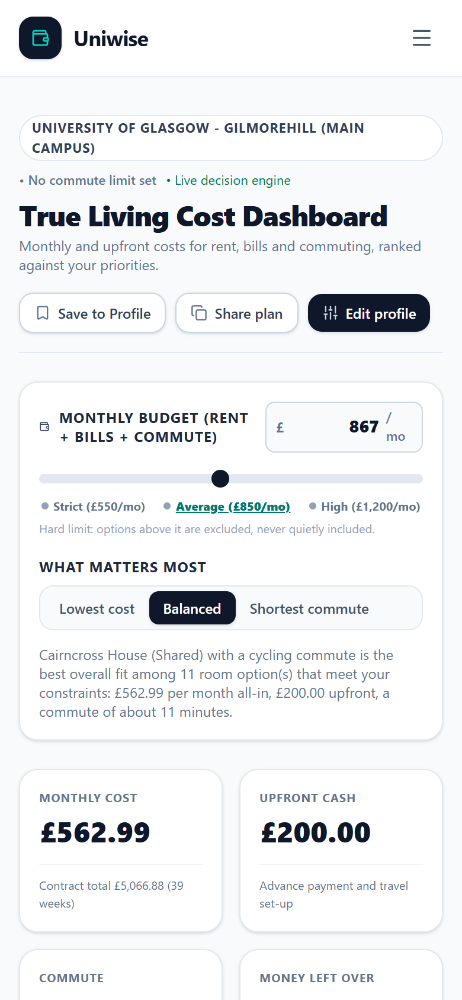

*The same dashboard at 390 px phone width.*

---

## 11. Responsible use of AI

**The recommendation uses no AI.** Rankings, costs, scores, reasons, trade-offs and next steps come from deterministic code in `backend/app/decision_engine/`, and tests check them. The same profile always gives the same answer.

**"Finley", the chat assistant, is rule-based, not a language model.** It matches keywords in the question (rent figures, area names, "bus", "NHS", "bank" and so on) and fills in pre-written answers (`frontend/web/src/shared/calculations/chat-engine.ts`). Its cost figures (for example estimated bills of £28.50 a week, or a 5-week deposit) are **illustrative general guidance**. They don't come from the decision engine and **don't affect any recommendation**. The chat client tries a `/api/v1/chat` endpoint first; the backend doesn't implement one, so the local rules always answer.

| Question from the brief | Our answer |
|---|---|
| Where was AI used? | **To build the product**, not inside it. The team wrote most of the code; AI coding assistants were used as a tool for drafting, refactoring, debugging, tests and documentation. The product calls no AI service at runtime. |
| What decisions stayed human? | **All the engineering decisions**: the architecture and three-layer split, the API contract, choosing data sources and what to exclude, transcribing and dating every curated figure, the scoring factors and hard-limit rules, failure handling, and every product and design decision. |
| How was output checked? | A team member reviewed every AI-suggested change before keeping it. The checks were 71 automated tests, ruff and type checks, and comparing curated figures against the official pages named in Section 6. |
| What happens if AI is unavailable or wrong? | Nothing depends on AI at runtime, so there's no AI failure path in the recommendation. If an LLM is added to Finley later, it will be grounded in the engine's structured output, checked against it, and fall back to the current rules. |

> An LLM call alone is not a solution. That's why the decision is made by a testable engine, and any future language layer would only turn its structured output into prose.

---

## 12. What is verified and what is illustrative

We would rather show this table than have a judge find the gaps.

| Area | Status |
|---|---|
| Accommodation (33 UofG room types), Subway fares, walk/cycle routes, Under-22s rules | **Verified data**: from official or public sources, with dates and statuses |
| Dashboard, Housing & bills, Commute options, landing-page trade-off | **Live**, from the backend decision engine |
| Supabase sign-in, profiles, saved plans | Working **when configured** with a Supabase project; optional for the demo |
| Banking comparison page | **Illustrative**: research leads, not verified against the banks' current terms; not used in any recommendation |
| NHS healthcare page | **Illustrative guidance**: general entitlements and a clinic directory that must be checked before relying on it; not used in any recommendation |
| Finley chat | **Rule-based and illustrative** (Section 11) |
| Mobile app (Expo) | Tries the backend first, but most of the endpoints it calls don't exist yet, so its tabs mostly run on local mock data |
| Bus and rail | **Not modelled**. Subway journey times are estimates |

<table>
<tr>
<td width="50%">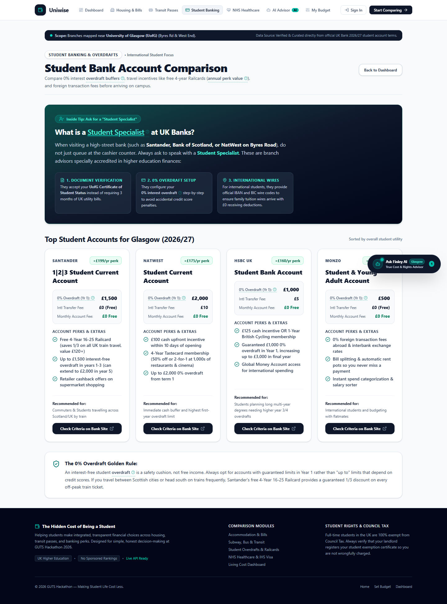</td>
<td width="50%">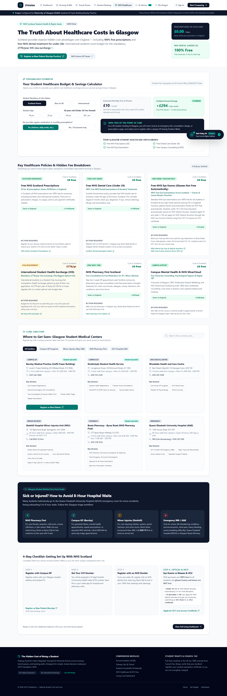</td>
</tr>
<tr>
<td><b>Banking</b>: illustrative comparison and "Student Specialist" guidance</td>
<td><b>Healthcare</b>: NHS Scotland entitlement guide and savings estimator</td>
</tr>
</table>

---

## 13. Submission checklist: where to find the evidence

| Brief checklist item | Where | Screenshot |
|---|---|---|
| One named user and one clear decision | Section 2; README "User and decision" | `hero-dashboard.png` |
| At least two independent sources | Seven sources: UofG, SPT, Transport Scotland, postcodes.io, NaPTAN, OSRM, UK Tram | `dashboard-sources-next-steps.png` |
| Normalisation, comparison or interpretation | Weekly → monthly, fares → cheapest ticket, routes → minutes, all in one schema; ranking and explanations | `dashboard-why.png`, `05-transport.png` |
| End-to-end path demonstrated | Onboarding → `POST /recommendations/setup` → dashboard | Section 4 |
| OpenAPI / Swagger contract | `docs/openapi.json`, `/docs` | `13-api-docs.png` |
| Separation of experience, decision and integration | `frontend/web` · `backend/app/decision_engine` · `backend/app/providers` | Section 7 diagram |
| Unit tests for core logic | `backend/tests/test_{constraints,costs,scoring,engine}.py` | n/a |
| At least one integration test | `backend/tests/test_api.py` (19 HTTP tests) | n/a |
| Graceful failure behaviour | Section 9 | `dashboard-no-feasible.png`, `dashboard-backend-down.png`, `09-errors.png` |
| No secrets committed; inputs validated | `.env.example`, `.gitignore`, Pydantic models | n/a |
| Clear README and prerequisites | [`README.md`](../README.md) | n/a |
| Clean setup instructions | Section 15; README "Quick start" | n/a |
| Architecture diagram and trade-offs | Section 7; README "Architectural trade-offs" | n/a |
| Accessible, cohesive interface | One flow built around one decision; responsive; reduced motion | `mobile-dashboard.png` |
| Source and recommendation explanations | "Why this option", runner-up line, "What we don't know", source panel | `dashboard-why.png` |
| AI usage and checks disclosed | Section 11 | n/a |
| Fallback if AI is unavailable or wrong | Section 11: no runtime AI dependency | n/a |

---

## 14. Screenshot index

All screenshots are in [`docs/screenshots/`](./screenshots/). They were taken on 18/10/2026 from the running Docker build, at 1440 px wide (close-ups at 2× resolution), using the example profile below.

**Example profile** (saved in the browser under `student_finance_profile`): University of Glasgow, international, age 19, budget limit £867/month as shown on the dashboard, max rent £200/week, 5 campus days, walk/cycle/Subway allowed, *Balanced* priority.

| File | Screen | What it proves | Use it for |
|---|---|---|---|
| `hero-dashboard.png` | Dashboard, top of page | Budget, priority switch, the four headline numbers, the top recommendation | **Cover image / first slide** |
| `dashboard-why.png` | Recommendation card | Reasons, runner-up comparison, unknowns, trade-offs | **"Explanation" slide** |
| `dashboard-score-ranking.png` | Score chart + ranked list | How each factor contributed; ranked alternatives | **"How it decides" slide** |
| `dashboard-shortest-commute.png` | Dashboard after "Shortest commute" | Personalisation: the winner changes, and the app says so | **"Personalised" slide** |
| `dashboard-sources-next-steps.png` | Upfront cash, next steps, sources | Upfront cash kept separate; actions with official links; provenance | **"Evidence" slide** |
| `landing-tradeoff-cost.png` / `landing-tradeoff-commute.png` | Landing-page trade-off | Same student, two priorities, two live answers | **Problem / pitch slide** |
| `dashboard-no-feasible.png` | Budget too low | Never recommends what breaks a hard limit; suggests what to relax | **"Graceful failure" slide** |
| `dashboard-backend-down.png` | Backend blocked | No fake figures when the API is down | **"Resilience" slide** |
| `mobile-dashboard.png` | 390 px phone | Responsive layout | Accessibility |
| `01-landing.png` | Landing page (full) | First impression, the problem, how it works | Devpost gallery |
| `02-onboarding.png` | Onboarding step 1 | Profile capture | Demo flow |
| `03-dashboard.png` | Dashboard (full page) | The whole decision on one page | Devpost gallery |
| `04-accommodation.png` | Housing & bills (full) | 33 official room types with unknowns shown | Data slide |
| `05-transport.png` | Commute options | Walk vs cycle vs Subway, ticket choice, status badges | Data slide |
| `06-banking.png` | Banking (illustrative) | Breadth of the student-cost picture | Appendix only |
| `07-healthcare.png` | Healthcare (illustrative) | NHS Scotland guidance | Appendix only |
| `08-chat.png` | Finley chat | Rule-based assistant (not AI) | Appendix only |
| `09-errors.png` | Error gallery | One screen per error code | Engineering slide |
| `10-not-found.png` | 404 | Custom not-found page | Engineering slide |
| `11-auth.png`, `12-profile.png` | Sign in / profile | Optional Supabase accounts | Appendix |
| `13-api-docs.png` | Swagger UI | API-first contract | **"API" slide** |

**Tips for retaking them:**

- Hide the floating *Ask Finley AI* button before capturing, because it covers content on the right-hand side.
- Take the *Shortest commute* and *no-feasible* shots straight after the *Balanced* one, so the change is obvious when the images are shown side by side.
- For the "backend down" shot, stop only the backend (`docker compose stop backend`), refresh the dashboard, then `docker compose start backend`.

---

## 15. Run it yourself

```bash
# Prerequisites: Docker Desktop (or Python 3.12+ and Node 20+)
docker compose up --build -d
# Web app:  http://localhost:3000
# API docs: http://localhost:8000/docs
docker compose run --rm --no-deps backend python -m pytest -q   # 71 tests
docker compose down
```

Then open **http://localhost:3000 → Start comparing**, complete the four onboarding steps, and follow [Section 4](#4-demo-walkthrough-3-minutes).

Supabase is optional. To try sign-in and saved plans, put a project's public URL and anon key in `.env` (see `.env.example`), run `supabase/migrations/` against it, and rebuild the web image.
